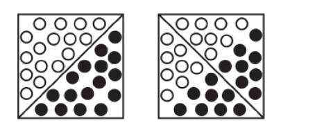

# Att mäta segregation {#sec-matmetoder}

Det finns flera metoder för att mäta och analysera segregation.I detta avsnitt kommer vi att gå igenom två av de vanligaste metoderna och beskriva dess för-och nackdelar. Den första metoden är den kanske mest vanliga och används oftast för att analysera områden. Den andra metoden kallas för k närmsta granne och används för att beskriva individens närmaste omgivning. 

## Områdesanalys {#sec-omradesanalys}
En av de vanligaste är områdesanalys, som oftast bygger på att områden klassificeras utifrån socioekonomiska faktorer. Exempel på sådana metoder är Statistiska centralbyråns (SCB:s) socioekonomiska index och Göteborgs Stads socioekonomiska områdesindelning. Metoderna utgår i regel från hur stor andel av befolkningen i ett område som tillhör olika grupper, baserat på ett antal socioekonomiska variabler. Områdena kan därefter jämföras med varandra, vilket gör det möjligt att dra slutsatser om hur förutsättningarna skiljer sig mellan exempelvis olika delar av en kommun.

Göteborgs socioekonomiska områdesindelning bygger på sex variabler, varav fyra är socioekonomiska och två rör boendemiljön. Statistiken har tagits fram för Göteborgs 96 primärområden, där två områden har exkluderats på grund av för få invånare. Med hjälp av en klusteranalys har områdena sedan grupperats i sex kluster utifrån deras socioekonomiska förutsättningar.

Den här typen av metod är vanlig inom segregationsområdet. En fördel är att områdena klassificeras utifrån de förutsättningar som finns, vilket gör resultaten lätta att kommunicera. Det är enkelt att förmedla att område A har sämre förutsättningar än område B. Metoden gör det också möjligt att beskriva skillnader på en övergripande nivå, till exempel inom en kommun, och att visa hur stora skillnaderna i förutsättningar är beroende på var man bor. I ett område kan exempelvis 50 procent av invånarna tillhöra en viss grupp, medan motsvarande andel i ett annat område är 5 procent. En sådan analys beskriver väl förutsättningarna i respektive område, och genom årliga uppföljningar går det att följa om ett område stärker eller försvagar sina förutsättningar över tid.

En kritik mot områdesbaserade metoder är att de helt förlitar sig på administrativa gränser. Det är oftast kommunen som drar sina egna gränser, i regel utifrån vissa principer, men gränserna behöver inte spegla hur människor faktiskt lever och rör sig. En person identifierar sig inte nödvändigtvis med område A bara för att bostaden råkar ligga på ena sidan av en administrativ gräns. Den som bor i utkanten av ett område kan i praktiken ha starkare koppling till, och röra sig mer i, ett angränsande område.

En närliggande kritik är det så kallade MAUP (Modifiable Areal Unit Problem). Problemet innebär att slutsatserna kan förändras kraftigt beroende på vilken geografisk skala som används och hur gränserna dras. Skalan spelar roll eftersom områden ofta skiljer sig mycket i befolkningsstorlek: i små områden blir andelar känsliga för slumpmässig variation, medan stora områden kan dölja stora skillnader inom området. Hur gränserna dras spelar roll även när skalan är densamma. Figuren nedan illustrerar detta. Till vänster visas en kommun med två grupper som bor helt åtskilda, och gränsdragningen fångar segregationen fullt ut. Till höger är boendemönstret exakt detsamma, men gränsen har dragits på ett annat sätt. Båda områdena består nu av ungefär lika stora andelar av de två grupperna, och segregationen syns inte längre i måttet, trots att den finns kvar.

{#fig-maup-gransdragning fig-alt="Svarta och vita cirklar har samma placering i två rutor. Olika diagonala gränser ger områden med åtskilda respektive blandade grupper." width=457}

## K närmsta granne {#sec-knn}
För att hantera dessa problem har man utvecklat metoder som inte utgår från administrativa gränser. En sådan är radiebaserade metoder, där befolkningens sammansättning beräknas inom cirklar med olika radie runt varje bostad. På så sätt kan segregationen mätas på flera skalnivåer. Metoden k-närmaste-grannar (k-NN) bygger vidare på samma tanke, men i stället för ett fast avstånd utgår den från ett fast antal grannar. Varje individs grannskap består då av exempelvis de 100 närmaste grannarna, oavsett hur långt bort de bor. Skillnaden kan uttryckas som att den radiebaserade metoden håller ytan konstant medan befolkningen varierar, medan k-NN håller befolkningen konstant medan ytan varierar.

En stor fördel med k-NN är att många av begränsningarna med administrativa områden försvinner. För varje individ skapas ett eget grannskap med ett förutbestämt antal grannar, vilket gör grannskapen jämförbara mellan individer. Grannskapen påverkas inte av administrativa gränser och speglar därför bättre hur individens närmaste boendemiljö faktiskt ser ut.

Även k-NN har dock begränsningar. Valet av antal grannar är i grunden godtyckligt, och resultatet påverkas av vilket k som används. Det hanteras ofta genom att segregationen beräknas för flera olika k, vilket samtidigt visar på vilken skala segregationen är som starkast. Eftersom grannskapet definieras av antal personer snarare än avstånd kan 100 grannar motsvara ett kvarter i innerstaden men flera kilometer i glesare bebyggda områden. Slutligen bygger k-NN, precis som områdesbaserade metoder, på var människor bor och fångar inte var de faktiskt rör sig i vardagen, till exempel i skolan, på arbetet eller på fritiden.

## Avslutande reflektion {#sec-reflektion}
Metoderna ska därför inte ses som konkurrerande utan som kompletterande. Områdesbaserade analyser har sin styrka i att de knyter an till de geografiska enheter där beslut fattas, resurser fördelas och verksamheter planeras. De bygger på data som är lättillgängliga och jämförbara över tid, och resultaten är enkla att kommunicera. k-NN ger i stället en mer rättvisande bild av hur segregerade människors boendemiljöer faktiskt är, oberoende av hur gränserna dragits, och gör det möjligt att analysera på vilken skala segregationen verkar. Tillsammans ger metoderna både en bild av var skillnaderna i förutsättningar finns och en mer robust bild av hur omfattande segregationen är.

```{=html}
<!-- Förklara vad respektive mått fångar och hur val av geografi och grupper påverkar det.
Här kan vi senare lägga in ett interaktivt, tydligt märkt fiktivt exempel. -->
```

