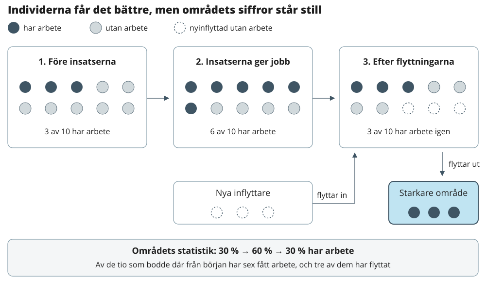

# Lyckoparadoxen {#sec-lyckoparadoxen}

I detta avsnitt kommer vi att analysera det som kallas för lyckoparadoxen och hur det ser ut i Göteborg.
Lyckoparadoxen innebär att satsningar i socioekonomiskt utsatta områden kan hjälpa människorna som bor där, utan att det syns i områdets statistik.
Det kan hända om de som får det bättre flyttar från området.
Förloppet kan beskrivas i fyra steg:

1.  Satsningar i området bidrar till att fler av de boende får arbete eller högre inkomst.

2.  Med större ekonomiska resurser ökar möjligheterna att välja bostad, och en del av dem som fått det bättre flyttar till andra områden.

3.  Bostäderna som blir lediga tas över av nya hushåll.
    Om de som flyttar in i genomsnitt har lägre inkomst eller svagare förankring på arbetsmarknaden än de som flyttade ut, förändras områdets sammansättning lite.

4.  Områdets statistik beskriver dem som bor där vid mättillfället.
    Andelen med arbete och medianinkomsten blir därför ungefär som tidigare, trots att många av dem som bodde där har fått det bättre.

{width="100%" fig-alt="Sex av tio invånare får arbete. Tre flyttar och ersätts av personer utan arbete, så områdets andel med arbete återgår till 30 procent."}

I skissen har sex av de tio ursprungliga invånarna arbete efter insatserna.
Tre av dem flyttar och ersätts av inflyttare utan arbete, så områdets andel med arbete är tillbaka på 30 procent.
I forskningen kallas mekanismen selektiv flyttning.
Flyttningar är en naturlig del av människors liv och inget problem i sig.
Problemet uppstår när satsningar bedöms enbart utifrån områdets statistik.
En oförändrad statistik behöver inte betyda att insatserna saknar effekt, och en förbättrad statistik kan bero på att andra har flyttat in snarare än på att de boende fått det bättre.
För att se effekten av en satsning behöver man därför också följa människorna, inte bara platsen.

## Sammanfattning {#sec-lycko-sammanfattning}

De tio primärområden som i stadens socioekonomiska områdesindelning 2026 har stora socioekonomiska utmaningar (kluster 1) förlorade 2000–2024 netto 19 400 förvärvsarbetande genom flyttningar, ungefär 21 per 1 000 boende 20–64 år och år.
Tre fjärdedelar av förlusten (14 700) gick till andra delar av Göteborg.
Områdena med särskilt goda förutsättningar (kluster 6) vann netto 9 400 förvärvsarbetande från resten av staden.

De som flyttar ut ur kluster 1 är oftare förvärvsarbetande än de som flyttar in, 53 mot 41 procent.
Skillnaden beror till stor del på att 28 500 av inflyttarna inte bodde i Sverige året före och därför inte kan ha arbetat här.
Bland flyttningar inom staden är skillnaden mindre, 55 mot 51 procent.
I kluster 6 är det tvärtom: inflyttare från resten av staden är oftare förvärvsarbetande än utflyttare, 85 mot 74 procent.

Kluster 1 hade en medianinkomst på 64 procent av stadens år 2000, 53 procent 2010 och 69 procent 2024.
Kluster 6 gick under samma tid från 130 till 143 procent, så avståndet mellan ytterligheterna har ökat.
Bland dem som bodde kvar i kluster 1 steg andelen förvärvsarbetande från 44 till 67 procent, men det syns bara delvis i områdenas statistik, eftersom många av dem som får det bättre flyttar.

## Flyttningar av förvärvsarbetande {#sec-lycko-flyttningar}

Områdena med stora socioekonomiska utmaningar förlorar förvärvsarbetande till resten av staden, och områdena med goda förutsättningar vinner dem.
Områdena grupperas här efter stadens socioekonomiska områdesindelning 2026, och samma indelning används för alla år.
Flyttningarna räknas per 1 000 boende, så att kluster av olika storlek kan jämföras.

Summerat över alla 25 år flyttade 20 500 fler personer från kluster 1 till andra delar av Göteborg än åt andra hållet, i genomsnitt drygt 800 per år.
Av dem var 14 700 förvärvsarbetande året före flytten, vilket motsvarar 15,5 förvärvsarbetande per 1 000 boende och år.
Flyttningar mellan två områden inom kluster 1 tar ut varandra och påverkar inte summan.
Kluster 6 vann på samma sätt netto 5 200 personer från resten av staden men 9 400 förvärvsarbetande.
Det förlorade alltså personer utan arbete och fick förvärvsarbetande i stället.

Alla kluster förlorar förvärvsarbetande i kategorin utvandrade och avlidna, eftersom den som invandrar inte kan ha arbetat i Sverige året före och därför aldrig väger upp.
Det säger mer om definitionen än om områdena.
Det som skiljer klustren åt är hur många som kommer: kluster 1 tog emot 28 500 personer som inte var folkbokförda i Sverige året före, kluster 6 7 700, trots att kluster 6 har ungefär lika många invånare.

```{=html}
<section id="lycko-cluster-flows" class="lycko-card lycko-cluster knn-widget" data-chart="flows" aria-labelledby="lycko-flows-title">
  <div class="lycko-heading"><h3 id="lycko-flows-title">Kluster 1 förlorar förvärvsarbetande till resten av staden, kluster 4 och 6 vinner</h3><div class="lycko-actions knn-actions"></div></div>
  <p class="knn-caption">Nettoflyttning av förvärvsarbetande per 1 000 boende 20–64 år och år, 2000–2024. Socioekonomisk indelning 2026.</p>
  <fieldset class="lycko-cluster-filters"><legend>Flyttningar</legend></fieldset>
  <div class="lycko-cluster-plot"></div>
  <details><summary>Visa diagrammets värden</summary><div class="lycko-table"></div></details>
  <p class="knn-caption">Källa: SCB, med bearbetning av Stadsledningskontoret i Göteborgs stad.</p>
  <p class="lycko-status" role="status"></p>
</section>
```

Inom staden är de som lämnar kluster 1 något oftare förvärvsarbetande än de som kommer, 55 mot 51 procent.
Den större skillnaden ligger i kluster 6, dit förvärvsarbetande flyttar i högre grad än de som flyttar därifrån.
Lyckoparadoxen syns alltså mest i hur många som flyttar ut ur kluster 1 och vilka som ersätter dem, och i att områden med goda förutsättningar drar till sig de förvärvsarbetande.

```{=html}
<section id="lycko-cluster-table" class="lycko-card" aria-labelledby="lycko-table-title">
  <div class="lycko-heading"><h3 id="lycko-table-title">Andel förvärvsarbetande året före, 2000–2024</h3><button type="button" class="lycko-csv">Ladda ner CSV</button></div>
  <div class="lycko-table" data-cluster-table></div>
  <p class="knn-caption">Källa: SCB, med bearbetning av Stadsledningskontoret i Göteborgs stad.</p>
  <noscript>Aktivera JavaScript för att visa den beräknade tabellen.</noscript>
</section>
```

## Inkomstutveckling {#sec-lycko-inkomst}

Kluster 1 ligger i dag bara något högre i förhållande till staden än år 2000, medan kluster 6 har dragit ifrån.
Diagrammet visar medianinkomsten i procent av stadens median, så att inflationen och den allmänna löneutvecklingen räknas bort.

Utvecklingen har tre faser.
Under 2000–2010 halkade kluster 1 efter, från 64 till 53 procent av stadens median, samtidigt som kluster 6 gick från 130 till 140 procent.
Under 2010–2020 kom kluster 1 tillbaka till 63 procent, och 2024 låg det på 69 procent.
Kluster 2 följer samma mönster men på en högre nivå, medan kluster 3–5 har legat nästan still.

Avståndet mellan kluster 1 och kluster 6 har därför ökat, från 66 till 74 procentenheter av stadens median.
Det stämmer med bilden från flyttningarna: kluster 6 tar emot förvärvsarbetande från resten av staden, medan kluster 1 förlorar dem.

```{=html}
<section id="lycko-cluster-income" class="lycko-card lycko-cluster knn-widget" data-chart="income" aria-labelledby="lycko-income-title">
  <div class="lycko-heading"><h3 id="lycko-income-title">Avståndet mellan kluster 1 och kluster 6 har ökat sedan 2000</h3><div class="lycko-actions knn-actions"></div></div>
  <p class="knn-caption">Medianinkomst 20–64 år i procent av Göteborgs median, 2000–2024. Socioekonomisk indelning 2026.</p>
  <fieldset class="lycko-cluster-filters"><legend>Socioekonomisk indelning 2026</legend></fieldset>
  <div class="lycko-cluster-plot"></div>
  <details><summary>Visa diagrammets värden</summary><div class="lycko-table"></div></details>
  <p class="knn-caption">Källa: SCB, med bearbetning av Stadsledningskontoret i Göteborgs stad.</p>
  <p class="lycko-status" role="status"></p>
</section>
```

## Exempel på enskilda områden {#sec-lycko-omraden}

Bland områdena med låg inkomst år 2000 skiljer sig utvecklingen mycket åt.
I Hjällbo, Hammarkullen och Norra Biskopsgården, som alla tillhör kluster 1, försvinner netto drygt 20 förvärvsarbetande per 1 000 boende och år.
Frölunda Torg och Gamlestaden ligger kring noll och tillhör i dag kluster 2 respektive 3.

De områden som har klarat sig bäst har vuxit kraftigt.
Frölunda Torg, Gamlestaden och Kvillebäcken har ungefär fördubblat antalet boende i arbetsför ålder, deras inkomst har stigit mot stadens nivå och de tillhör i dag kluster 2 eller 3.
En möjlig förklaring är att nybyggda bostäder lockar inflyttare med arbete och högre inkomst.
Det har dock inte prövats här.
Eriksbo går i motsatt riktning: området har den största nettoförlusten av förvärvsarbetande och har gått från 85 till 64 procent av stadens medianinkomst.
Området är litet, så enskilda år kan väga tungt.

I diagrammet nedan kan du se hur varje område har utvecklats över tid på variablerna kumulativt flyttnetto av förvärvsarbetande personer och medianinkomsten.Varje punkt är ett primärområde.
På den vågräta axeln visas medianförvärvsinkomsten för valt år, omräknad till 2024 års prisnivå.
På den lodräta axeln visas flyttnettot av förvärvsarbetande, summerat från 2000 till och med valt år.
Positiva värden innebär sammantaget fler inflyttare än utflyttare med arbete.
Negativa värden innebär fler utflyttare än inflyttare med arbete.Färgerna visar den socioekonomiska indelningen **2026** för hela perioden.
Indelningen bygger på statistik från 2024 och beskriver alltså inte områdets grupp det år som väljs i diagrammet.
Folkmängden avser samtliga åldrar vid slutet av respektive år.

```{=html}
<section id="lycko-card" class="lycko-card knn-widget" aria-labelledby="lycko-title">
  <div class="lycko-heading"><h3 id="lycko-title">Medianinkomst och kumulativt flyttnetto</h3><div class="lycko-actions knn-actions"></div></div>
  <p class="lycko-period knn-caption"></p>
  <div class="lycko-controls">
    <details class="lycko-area-picker"><summary>Välj områden</summary><div class="lycko-area-panel"><label for="lycko-area-search">Sök område</label><input id="lycko-area-search" type="search" placeholder="Namn eller områdeskod" autocomplete="off"><button type="button" data-clear>Rensa val</button><div class="lycko-area-options"></div><p class="lycko-search-empty" hidden>Inga områden matchar sökningen.</p></div></details>
    <div class="knn-slider"><label for="lycko-year">År: <strong><output id="lycko-year-value">2024</output></strong></label>
      <div class="knn-play-row"><button id="lycko-play" class="knn-play" type="button" aria-label="Spela år" aria-pressed="false"><span aria-hidden="true">▶</span></button><div class="knn-range-wrap"><input id="lycko-year" type="range" min="0" max="24" value="24" step="1" aria-label="År i diagrammet"><div class="knn-range-ends"><span>2000</span><span>2024</span></div></div></div>
    </div>
  </div>
  <p class="lycko-axis-label">Kumulativt flyttnetto (förvärvsarbetande)</p>
  <div class="lycko-chart"></div>
  <fieldset class="lycko-legend"><legend>Socioekonomisk indelning 2026. Välj vilka grupper som visas.</legend></fieldset>
  <div class="lycko-size-legend"></div>
  <details><summary>Visa diagrammets värden</summary><div class="lycko-table"><table class="knn-table"><caption></caption><thead><tr><th>Primärområde</th><th>Medianinkomst (kr)</th><th>Kumulativt flyttnetto</th><th>Årets flyttnetto</th><th>Folkmängd</th><th>Grupp 2026</th></tr></thead><tbody></tbody></table></div></details>
  <p class="knn-caption">Källa: SCB, med bearbetning av Stadsledningskontoret i Göteborgs stad.</p>
  <p class="lycko-status" role="status" aria-live="polite"></p>
  <div class="lycko-tooltip" hidden></div>
</section>
```

**Osäkerheter och vad som kan ändra slutsatserna**

- Förvärvsarbetande är ett grovt mått på framgång.
  Den som har ett lågt betalt jobb räknas likadant som den med hög lön.
  Lyckoparadoxen kan vara starkare i inkomst än i sysselsättning.
  Det kan prövas genom att jämföra inkomsten året före flytten mellan in- och utflyttare.

- Ålder och livsfas styr flyttningarna.
  Unga flyttar ofta till billigare områden och vidare när de får jobb och familj.
  En del av mönstret kan därför vara vanlig livscykel snarare än segregation.
  Uttaget kan delas upp på åldersgrupper för att pröva det.

- Vart utflyttarna flyttar är okänt.
  Uttaget visar att de flyttar till andra delar av staden men inte till vilka områden.
  En matris över från- och till-område skulle visa om de förvärvsarbetande flyttar till områden med högre inkomst.

- Tidsseriebrott i sysselsättningen.
  Måttet byttes från SyssStat till BASAlt mellan 2021 och 2022, vilket påverkar flyttåren 2023–2024.
  Andelen förvärvsarbetande bland kvarboende i kluster 1 steg från 62 till 66 procent just det året, och en del av det kan vara måttbytet.

- Klustren bygger på hur områdena ser ut i dag.
  Ett område kan ligga i kluster 1 delvis för att förvärvsarbetande har flyttat därifrån, och områden som förbättrats har hamnat i högre kluster.
  Det gör skillnaderna mellan klustren något större än om grupperna bestämts i början av perioden.
  Som kontroll har områdena också grupperats efter inkomst 2000–2002: flyttmönstret blir detsamma, men då har de fattigaste områdena närmat sig staden i stället för att halka efter.
